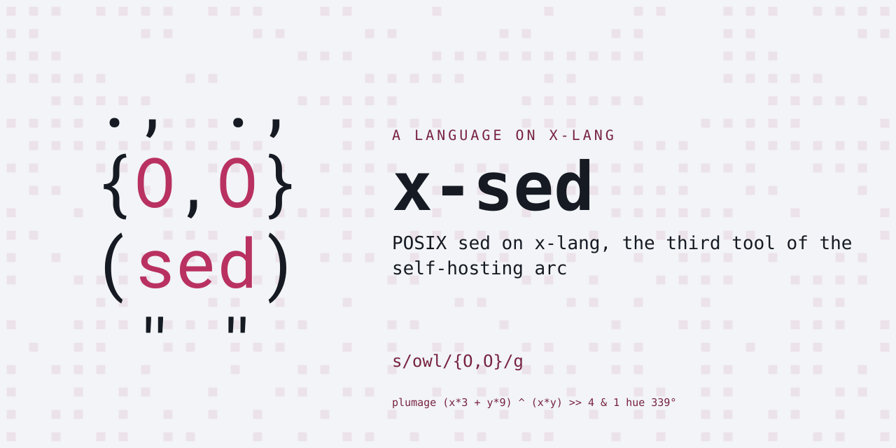
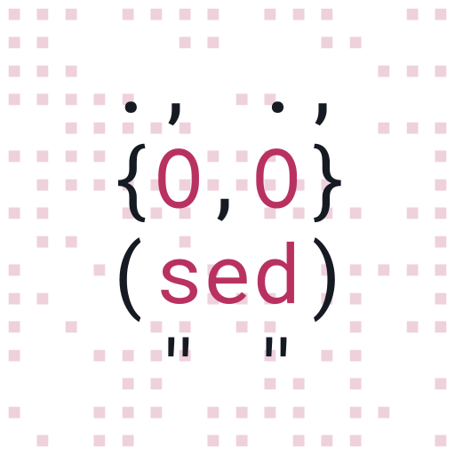

# x-sed — sed on x-lang

A sed written in [x-lang](https://github.com/jonruttan/x-lang), loaded as
a lang. It is a subset of POSIX sed: substitution, addresses and the
commands `p`, `d` and `q`.

    printf 'hello world\n' | x -l sed 's/world/x-lang/'
    x -l sed -- -n '/start/,/end/p' log.txt

It is the middle ground between GNU sed, BSD sed and the others, on
portable idioms; no one sed is its reference, and every spec expectation
comes from a real sed run.

## Status

Pre-release: no release has been cut. Paired with x-lang v0.53.0
(`lang.xon` is the checkable row). It requires
[x-grep](https://github.com/jonruttan/x-grep), installed or beside it:
`(requires-lang "grep")` loads x-grep as a library, and the BRE
translation and the line reading are x-grep's.

## What it does

- **`s///`** with any delimiter, the `g` and `p` flags and an Nth
  occurrence, and `&` and `\1` to `\9` in the replacement.
- **Addresses:** line numbers, `$`, `/re/`, two-address ranges, and `!`.
- **Commands:** `p`, `d`, `q`, and `{ }` groups.
- **Options:** `-n`, `-E` (and `-r`), `-e` fragments and `-f` script
  files, in the order given.
- **Files** are one stream: line numbers continue across them, and `$`
  is the last line of the last.
- **Status** 0 or 1.

## Not supported

Each of these is refused by name:

- the hold space: `h`, `H`, `g`, `G`, `x`;
- the multiline commands: `N`, `D`, `P`;
- `a`, `i` and `c` text;
- `y///`;
- an empty `//`, which POSIX reads as the last regular expression used.

Options come before the script: they stop at the first operand.

## Install

It needs x-lang at the release `lang.xon` declares, and x-grep installed
first.

    make install        # into the x on PATH

## Running it

    x -l sed -- [-nrE] [-e script]... [-f scriptfile]... [script] [file]...

`--` ends x's own options, so sed's can follow it. A line with no
options of sed's needs no `--`.

## Development

    make test           # the suite
    make check          # the suite against tests/contract/known-failures.txt

`(sed-run ARGV INPUT-TEXT)` is the core, and the suite calls it directly.
The harness loads the x-grep bundle the way the wrapper does.

## Layout

    lang.xon          what the bundle is, with (requires-lang "grep")
    run.x             the entry
    sed/base.x        the parts, assembled
    sed/parse.x       script text to compiled commands; a regular
                      expression compiles through x-grep's translator
    sed/exec.x        the cycle: addresses, ranges, s///, the commands
    sed/cli.x         options, files, standard input, and sed-main
    tests/            markdown specs, run by the platform's runner

## Licence

MIT No Attribution (MIT-0). See [LICENSE](LICENSE).

